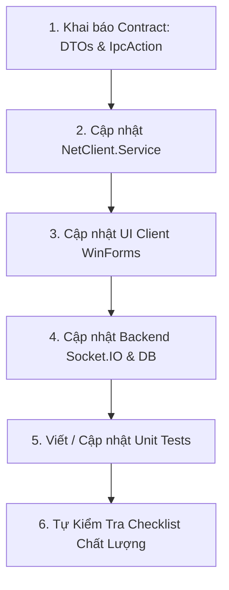

# Hướng Dẫn & Quy Tắc Dành Cho AI Code Agent (Backend ⇄ NetClient)
*Tài liệu định hướng kiến trúc, ràng buộc bất biến và quy trình chuẩn khi AI Agent thực hiện thêm tính năng.*

---

## 1. Vai Trò & Tổng Quan Hệ Thống

Bạn là một AI Software Engineer đang làm việc trên hệ thống quản lý phòng net (Cyber Cafe Management System). Hệ thống gồm 2 thành phần chính:
1. **Backend (Node.js)**: RESTful API (Express), Realtime Socket.IO v4, ORM Sequelize (MySQL).
2. **Client Máy Trạm (C# .NET - NetClient)**:
   - `NetClient.Shared`: Thư viện Class Library chia sẻ DTOs, Enums, IPC Message.
   - `NetClient.Service`: Windows Background Service (chạy ngầm dưới quyền `LocalSystem` / Session 0). Chịu trách nhiệm kết nối Socket.IO, giám sát phần cứng, chạy lệnh hệ điều hành và làm Named Pipe IPC Server.
   - `NetClient.UI`: Ứng dụng WinForms hiển thị màn hình khóa toàn màn hình (`LockOverlay`) trong User Session.
   - `NetClientApp`: Ứng dụng WinForms thanh công cụ tiện ích cho khách (`MainScreen` - nút đăng xuất, thông tin tài khoản) trong User Session.

---

## 2. Các Ràng Buộc Bất Biến Bắt Buộc Tuân Thủ (Critical Invariants)

Khi thực hiện bất kỳ thay đổi nào liên quan đến Client và Backend, bạn **BẮT BUỘC** phải tuân thủ nghiêm ngặt các nguyên tắc sau:

### ⚠️ NGUYÊN TẮC 1: ĐỊNH DANH MÁY TRẠM TRONG CSDL
- **TUYỆT ĐỐI KHÔNG** dùng `machineId`, `computer_name` hay `hostname` để query bảng `computer` trong CSDL từ Socket handler.
- **BẮT BUỘC** dùng hàm `findComputer(machine)` hoặc truy vấn kết hợp:
  ```javascript
  {
      where: {
          [Op.or]: [
              { ip_address: machine.localIp },
              { mac_address: machine.macAddress }
          ]
      }
  }
  ```
- **Lý do**: Tên máy tính Windows do người dùng đặt có thể trùng lặp hoặc thay đổi, duy nhất chỉ có Card mạng vật lý (MAC) và IP LAN cấp phát là đáng tin cậy.

### ⚠️ NGUYÊN TẮC 2: BẢO VỆ SCHEMA & MODEL CSDL
- **TUYỆT ĐỐI KHÔNG** tự ý sửa đổi cấu trúc bảng, migration hoặc thêm cột vào các Model Sequelize hiện có (`backend/src/models/`).
- Tận dụng triệt để các bảng và trường đã có sẵn: `Computer`, `ComputerStatusLog`, `User`, `Member`, `ComboTime`.

### ⚠️ NGUYÊN TẮC 3: GHI NHẬN AUDIT LOG TRẠNG THÁI MÁY
- Bất kỳ thao tác nào làm thay đổi trạng thái của máy (`ONLINE`, `IN_USE`, `LOCKED`, `OFFLINE`) **BẮT BUỘC** phải gọi:
  ```javascript
  await recordStatusChange(computer, previousStatus, newStatus, memberId, transaction);
  ```
- Luôn gọi `machineStore.updateStatus(...)` và `broadcastUpdate()` để đồng bộ tới Web Admin Dashboard.

### ⚠️ NGUYÊN TẮC 4: AN TOÀN ĐA LUỒNG WINFORMS (UI THREAD SAFETY)
- Windows Forms không cho phép cập nhật control giao diện từ luồng khác.
- Mọi callback nhận từ `IpcClientService` hay sự kiện nền khi tác động vào UI **BẮT BUỘC** phải kiểm tra `InvokeRequired`:
  ```csharp
  if (InvokeRequired)
  {
      BeginInvoke(new Action(() => ProcessUiUpdate(data)));
      return;
  }
  ProcessUiUpdate(data);
  ```

### ⚠️ NGUYÊN TẮC 5: AN TOÀN IPC NAMED PIPE
- `IpcServerService` phục vụ đồng thời cả `LockOverlay` và `NetClientApp`.
- Khi ghi dữ liệu vào pipe, **BẮT BUỘC** phải dùng cơ chế khóa đồng bộ (`SemaphoreSlim _sendLock`) để tránh phân mảnh JSON giữa các luồng.

### ⚠️ NGUYÊN TẮC 6: FILE SCRIPT WINDOWS (.BAT)
- Mọi file kịch bản batch (`.bat`) **BẮT BUỘC dùng tiếng Việt KHÔNG DẤU** hoặc tiếng Anh để tránh lỗi mã hóa ký tự (encoding charset) khi chạy trên các phiên bản Windows khác nhau.

---

## 3. Bản Đồ File Quan Trọng (File Map)

Khi làm việc, hãy tra cứu đúng file theo chức năng:

| Thành phần | Vị trí file | Trách nhiệm |
|:---|:---|:---|
| **Backend Socket Server** | [`backend/src/sockets/machineSocket.js`](file:///d:/TLCN/TLCN/TLCN/backend/src/sockets/machineSocket.js) | Lắng nghe kết nối socket từ máy trạm, nhận ACK, xử lý logout/login, gọi DB. |
| **Backend Push Service** | [`backend/src/services/computerSocketService.js`](file:///d:/TLCN/TLCN/TLCN/backend/src/services/computerSocketService.js) | Cung cấp hàm cho Controller gọi để emit lệnh xuống máy trạm (`this.io.to(...)`). |
| **Backend Memory Store** | [`backend/src/stores/machineStore.js`](file:///d:/TLCN/TLCN/TLCN/backend/src/stores/machineStore.js) | Lưu cache thông tin socket id, IP, MAC, trạng thái của các máy đang online trong RAM. |
| **C# Shared IPC Contracts** | [`NetClient/NetClient.Shared/Ipc/IpcMessages.cs`](file:///d:/TLCN/TLCN/TLCN/NetClient/NetClient.Shared/Ipc/IpcMessages.cs) | Enum `IpcAction`, class `IpcMessage`, hằng số `IpcConstants.PipeName`. |
| **C# Shared Socket DTOs** | [`NetClient/NetClient.Shared/Models/SocketContracts.cs`](file:///d:/TLCN/TLCN/TLCN/NetClient/NetClient.Shared/Models/SocketContracts.cs) | DTO serialization nhận và gửi Socket.IO với Backend. |
| **C# Background Service** | [`NetClient/NetClient.Service/Services/SocketService.cs`](file:///d:/TLCN/TLCN/TLCN/NetClient/NetClient.Service/Services/SocketService.cs) | Quản lý SocketIOClient v4, đăng ký listener và gửi emit. |
| **C# IPC Server** | [`NetClient/NetClient.Service/Services/IpcServerService.cs`](file:///d:/TLCN/TLCN/TLCN/NetClient/NetClient.Service/Services/IpcServerService.cs) | NamedPipeServer đa client, đồng bộ trạng thái khi UI mới kết nối. |
| **C# Customer Dock App** | [`NetClient/NetClientApp/Forms/MainScreen.cs`](file:///d:/TLCN/TLCN/TLCN/NetClient/NetClientApp/Forms/MainScreen.cs) | Form WinForms thanh tiện ích khách hàng, nút Logout. |
| **C# Lock Screen** | [`NetClient/NetClient.UI/Forms/LockOverlay.cs`](file:///d:/TLCN/TLCN/TLCN/NetClient/NetClient.UI/Forms/LockOverlay.cs) | Form màn hình khóa toàn màn hình `TopMost`. |

---

## 4. Quy Trình 6 Bước Chuẩn Khi Thêm Tính Năng Mới

Khi nhận yêu cầu thêm tính năng tương tác Backend ⇄ Client, AI Agent hãy thực hiện tuần tự theo 6 bước:



### Bước 1: Khai báo Contract chung
1. Thêm action mới vào `IpcAction` tại [`IpcMessages.cs`](file:///d:/TLCN/TLCN/TLCN/NetClient/NetClient.Shared/Ipc/IpcMessages.cs).
2. Nếu có payload Socket.IO mới, tạo class DTO tại [`SocketContracts.cs`](file:///d:/TLCN/TLCN/TLCN/NetClient/NetClient.Shared/Models/SocketContracts.cs).

### Bước 2: Xử lý tại `NetClient.Service`
1. Đăng ký listener Socket hoặc IPC trong [`SocketService.cs`](file:///d:/TLCN/TLCN/TLCN/NetClient/NetClient.Service/Services/SocketService.cs).
2. Điều phối chuyển tiếp tin nhắn qua `_ipcServerService.SendMessageAsync(...)`.
3. Bọc toàn bộ trong `try-catch` và log thông tin qua `_logger`.

### Bước 3: Xử lý trên UI (`NetClientApp` hoặc `NetClient.UI`)
1. Bổ sung hàm gửi hoặc nhận trong `IpcClientService.cs`.
2. Trong Form (`MainScreen.cs` hoặc `LockOverlay.cs`), nhận event và dùng `BeginInvoke` cập nhật UI.

### Bước 4: Xử lý tại Backend
1. Trong [`backend/src/services/computerSocketService.js`](file:///d:/TLCN/TLCN/TLCN/backend/src/services/computerSocketService.js): Bổ sung hàm emit nếu là chiều Server $\to$ Client.
2. Trong [`backend/src/sockets/machineSocket.js`](file:///d:/TLCN/TLCN/TLCN/backend/src/sockets/machineSocket.js): Lắng nghe event/ACK, tra cứu máy bằng `findComputer(machine)`, cập nhật DB, ghi `recordStatusChange` và gọi `broadcastUpdate()`.

### Bước 5: Kiểm thử tự động (Testing)
1. Thêm test case vào `NetClient.Tests/` (dùng xUnit và Moq).
2. Chạy kiểm thử:
   ```powershell
   dotnet test NetClient/NetClient.Tests/NetClient.Tests.csproj
   ```
3. Chạy test backend nếu có thay đổi logic server:
   ```powershell
   cd backend && npm test
   ```

### Bước 6: Tự kiểm tra Checklist (Self-Verification)
Trước khi bàn giao kết quả cho người dùng, AI Agent phải rà soát:
- [ ] Không có câu lệnh tìm `Computer` nào bằng `machineId`.
- [ ] Không có sự kiện WinForms nào gọi trực tiếp controls mà thiếu `InvokeRequired`.
- [ ] IPC Pipe gửi có bọc trong Semaphore lock.
- [ ] Mọi thay đổi trạng thái đều gọi `recordStatusChange(...)`.
- [ ] Toàn bộ test suite pass 100%.
