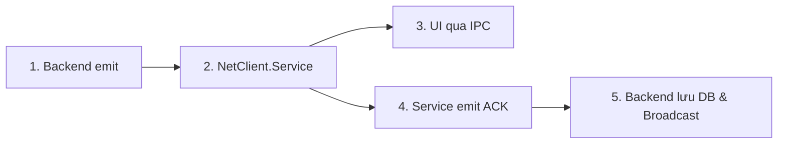
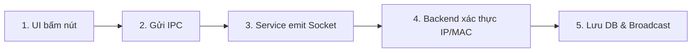

# Hướng Dẫn Nhanh: Quy Trình Code Tương Tác Backend ⇄ NetClient
*(Bản tóm tắt hành động dành cho Lập trình viên đã nắm kiến trúc)*

> [!NOTE]
> Tài liệu này lược giản toàn bộ lý thuyết từ [QUY_TRINH_TUONG_TAC_BACKEND_CLIENT.md](file:///d:/TLCN/TLCN/TLCN/docs/QUY_TRINH_TUONG_TAC_BACKEND_CLIENT.md). Dùng file này như một **Cheat Sheet** để code nhanh từng bước khi thêm tính năng mới.

---

## 1. Sơ Đồ Luồng Tổng Quát (3 Tầng)

```
[ Backend Node.js ]
        │  ▲
        │  │ Socket.IO (Realtime) / HTTP REST API
        ▼  │
[ NetClient.Service ]  (Chạy ngầm SYSTEM, quản lý kết nối & phần cứng)
        │  ▲
        │  │ Windows Named Pipe IPC (NetClient_Ipc_Pipe)
        ▼  │
[ UI: LockOverlay / NetClientApp ]  (Chạy trong User Session, WinForms)
```

---

## 2. Cheat Sheet 3 Kịch Bản Phát Triển

### Kịch Bản 1: Server Đẩy Lệnh Xuống Client (Server-to-Client Push)
*Ví dụ: Khóa máy từ xa, mở máy combo, gửi thông báo, tắt máy.*



1. **Backend Emit**:
   - File: [`backend/src/services/computerSocketService.js`](file:///d:/TLCN/TLCN/TLCN/backend/src/services/computerSocketService.js)
   - Code: `this.io.to(`machine:${machineId}`).emit('custom:event', { ...data });`
2. **NetClient.Service Lắng Nghe**:
   - File: [`NetClient.Service/Services/SocketService.cs`](file:///d:/TLCN/TLCN/TLCN/NetClient/NetClient.Service/Services/SocketService.cs)
   - Đăng ký `_client.On("custom:event", async ctx => { ... })`
   - Bắn IPC sang UI: `await _ipcServerService.SendMessageAsync(new IpcMessage { Action = IpcAction.CustomAction, Message = ... });`
   - Phản hồi ACK: `await _client.EmitAsync("custom:ack", [new { MachineId = _sessionService.MachineId, Success = true }]);`
3. **Thêm IPC Action**:
   - File: [`NetClient.Shared/Ipc/IpcMessages.cs`](file:///d:/TLCN/TLCN/TLCN/NetClient/NetClient.Shared/Ipc/IpcMessages.cs)
   - Thêm enum: `IpcAction.CustomAction`
4. **UI Tiếp Nhận**:
   - File: [`NetClientApp/Services/IpcClientService.cs`](file:///d:/TLCN/TLCN/TLCN/NetClient/NetClientApp/Services/IpcClientService.cs) (hoặc `NetClient.UI`):
   - Bắt action trong `HandleIncomingMessage`: Kích hoạt event C# `OnCustomAction?.Invoke(...)`.
   - File Form: [`MainScreen.cs`](file:///d:/TLCN/TLCN/TLCN/NetClient/NetClientApp/Forms/MainScreen.cs) dùng `BeginInvoke` cập nhật giao diện an toàn đa luồng.
5. **Backend Nhận ACK & Cập Nhật CSDL**:
   - File: [`backend/src/sockets/machineSocket.js`](file:///d:/TLCN/TLCN/TLCN/backend/src/sockets/machineSocket.js)
   - Lắng nghe `socket.on('custom:ack', async (data) => { ... })`
   - **Bắt buộc**: Dùng `findComputer(machine)` (qua IP/MAC), cập nhật CSDL, gọi `recordStatusChange(...)`, và `broadcastUpdate()`.

---

### Kịch Bản 2: Client Gửi Hành Động Lên Server (Client-to-Server Action)
*Ví dụ: Khách nhấn Logout, gọi dịch vụ, đăng nhập tại máy.*



1. **UI Kích Hoạt Thao Tác**:
   - File Form ([`MainScreen.cs`](file:///d:/TLCN/TLCN/TLCN/NetClient/NetClientApp/Forms/MainScreen.cs)): Disable nút bấm, gọi `await _ipcClient.SendCustomActionAsync(...)`.
2. **Gửi IPC Sang Service**:
   - File: [`NetClientApp/Services/IpcClientService.cs`](file:///d:/TLCN/TLCN/TLCN/NetClient/NetClientApp/Services/IpcClientService.cs)
   - Code: `await SendMessageAsync(new IpcMessage { Action = IpcAction.CustomAction, Message = ... });`
3. **IpcServerService Kích Hoạt Event**:
   - File: [`NetClient.Service/Services/IpcServerService.cs`](file:///d:/TLCN/TLCN/TLCN/NetClient/NetClient.Service/Services/IpcServerService.cs)
   - Bắt `IpcAction.CustomAction` -> kích hoạt `event Func<Task>? CustomActionRequested`.
4. **SocketService Đẩy Lên Socket.IO**:
   - File: [`NetClient.Service/Services/SocketService.cs`](file:///d:/TLCN/TLCN/TLCN/NetClient/NetClient.Service/Services/SocketService.cs)
   - Code: `await _client.EmitAsync("client:custom_action", [new { MachineId = _sessionService.MachineId, ... }]);`
5. **Backend Tiếp Nhận & Ghi CSDL**:
   - File: [`backend/src/sockets/machineSocket.js`](file:///d:/TLCN/TLCN/TLCN/backend/src/sockets/machineSocket.js)
   ```javascript
   socket.on('client:custom_action', async (data) => {
       const machine = machineStore.get(data.machineId);
       if (!machine || machine.socketId !== socket.id) return;
       const computer = await findComputer(machine); // KHÔNG tìm bằng machineId!
       if (!computer) return;
       // Cập nhật CSDL qua transaction & recordStatusChange
       broadcastUpdate();
   });
   ```

---

### Kịch Bản 3: Client Truy Vấn Dữ Liệu Cấu Trúc (Client Queries Backend)
*Ví dụ: Menu dịch vụ, danh sách món ăn, số dư tài khoản, thời gian còn lại.*

> [!TIP]
> Truy vấn dữ liệu có cấu trúc/danh mục lớn **luôn ưu tiên dùng HTTP REST API**, không dùng Socket.IO.

1. **Backend Route & Controller**:
   - Tạo REST endpoint: `GET /api/customer/...` trong `backend/src/routes/` và `backend/src/controllers/`.
2. **Client C# API Service**:
   - Tạo class tương tự [`AuthApiService.cs`](file:///d:/TLCN/TLCN/TLCN/NetClient/NetClient.Service/Services/AuthApiService.cs) sử dụng `HttpClient`.
   - Lấy URL từ `configuration["Server:Url"]`.
3. **DTO Model**:
   - Định nghĩa DTO mapping JSON trong [`NetClient.Shared/Models/`](file:///d:/TLCN/TLCN/TLCN/NetClient/NetClient.Shared/Models/).
4. **Hiển Thị WinForms**:
   - Gọi `await apiService.GetDataAsync()` và binding vào controls WinForms.

---

## 3. Bảng Vị Trí File Cần Sửa Cho Từng Tác Vụ

| Nghiệp vụ cần làm | File phía Backend | File phía NetClient C# |
|:---|:---|:---|
| **Thêm sự kiện Socket mới** | [`backend/src/sockets/machineSocket.js`](file:///d:/TLCN/TLCN/TLCN/backend/src/sockets/machineSocket.js)<br>[`backend/src/services/computerSocketService.js`](file:///d:/TLCN/TLCN/TLCN/backend/src/services/computerSocketService.js) | [`NetClient.Service/Services/SocketService.cs`](file:///d:/TLCN/TLCN/TLCN/NetClient/NetClient.Service/Services/SocketService.cs)<br>[`NetClient.Shared/Models/SocketContracts.cs`](file:///d:/TLCN/TLCN/TLCN/NetClient/NetClient.Shared/Models/SocketContracts.cs) |
| **Thêm giao tiếp IPC Service ⇄ UI** | *(Không liên quan)* | [`NetClient.Shared/Ipc/IpcMessages.cs`](file:///d:/TLCN/TLCN/TLCN/NetClient/NetClient.Shared/Ipc/IpcMessages.cs)<br>[`NetClient.Service/Services/IpcServerService.cs`](file:///d:/TLCN/TLCN/TLCN/NetClient/NetClient.Service/Services/IpcServerService.cs)<br>[`NetClientApp/Services/IpcClientService.cs`](file:///d:/TLCN/TLCN/TLCN/NetClient/NetClientApp/Services/IpcClientService.cs) |
| **Thêm nút bấm / form hiển thị** | *(Không liên quan)* | [`NetClientApp/Forms/MainScreen.cs`](file:///d:/TLCN/TLCN/TLCN/NetClient/NetClientApp/Forms/MainScreen.cs)<br>[`NetClient.UI/Forms/LockOverlay.cs`](file:///d:/TLCN/TLCN/TLCN/NetClient/NetClient.UI/Forms/LockOverlay.cs) |
| **Gọi API REST** | `backend/src/routes/`<br>`backend/src/controllers/` | `NetClient.Service/Services/*ApiService.cs` |

---

## 4. 5 Nguyên Tắc Bất Di Bất Dịch (Bắt Buộc Nhớ)

1. **Tuyệt đối KHÔNG tìm máy tính trong CSDL bằng `machineId`**: Bắt buộc dùng `findComputer(machine)` (dò bằng `localIp` và `macAddress`).
2. **Không sửa đổi cấu trúc Model CSDL hiện có**: Tận dụng triệt để các bảng `Computer`, `ComputerStatusLog`, `Member`, `ComboTime` đã có.
3. **Mọi thay đổi trạng thái máy (`ONLINE`, `IN_USE`, `OFFLINE`)**: Đều phải ghi log qua `recordStatusChange(...)`.
4. **An toàn đa luồng WinForms**: Mọi cập nhật UI từ sự kiện IPC phải bọc trong `if (InvokeRequired) { BeginInvoke(...); return; }`.
5. **Đồng bộ hóa gửi IPC**: Sử dụng `SemaphoreSlim` (`_sendLock`) khi ghi dữ liệu vào Named Pipe để tránh xung đột gói tin JSON.
