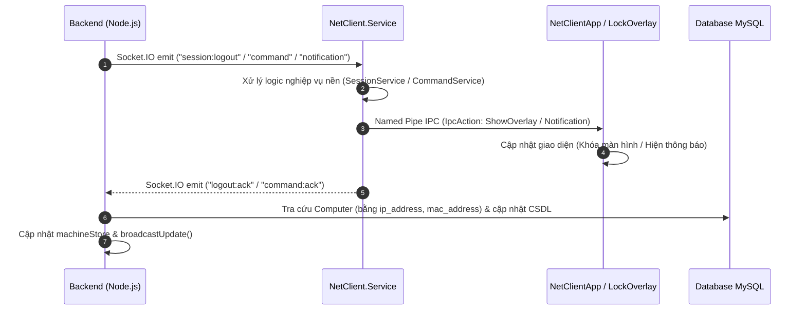
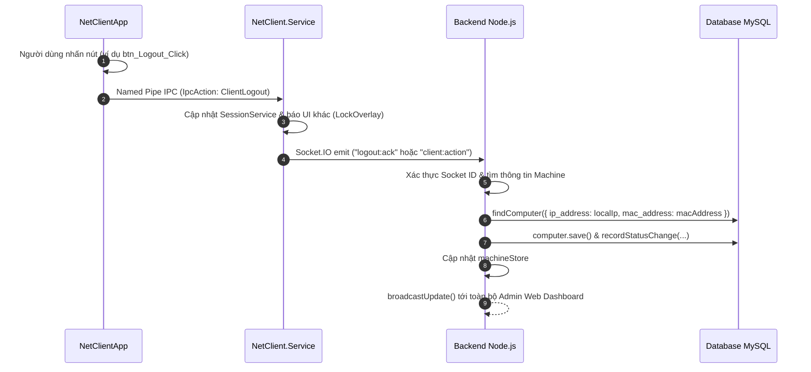
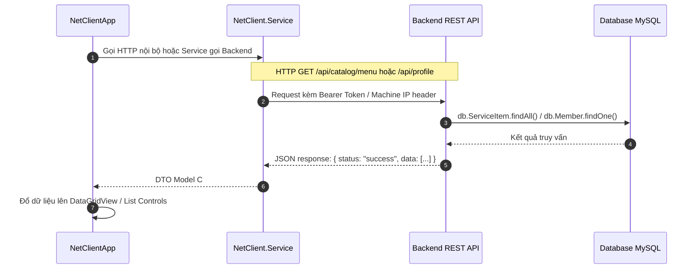

# Quy Trình Phát Triển Tính Năng Tương Tác Giữa Backend và Client (NetClient)

Tài liệu này chuẩn hóa kiến trúc và quy trình từng bước để lập trình viên phát triển thêm các tính năng mới liên quan đến giao tiếp giữa **Backend (Node.js)** và hệ thống **Client máy trạm (C# .NET - NetClient)**.

---

## 1. Tổng Quan Kiến Trúc Hệ Thống (Architecture Overview)

Hệ thống phòng net gồm 3 tầng tiến trình:

```
[ Backend Server (Node.js) ]
  ├── Socket.IO Server (machineSocket.js)  <── WebSockets Realtime
  ├── RESTful API (Express Controllers)    <── HTTP Requests
  └── Database (MySQL / Sequelize Models)
          ▲
          │ Mạng LAN (Socket.IO + HTTP)
          ▼
┌────────────────────────────────────────────────────────────────┐
│  NetClient.Service (Windows Background Service / SYSTEM)       │
│  ├── SocketService: Quản lý kết nối Socket.IO, Reconnect, ACK  │
│  ├── SessionService: State Machine (ONLINE, IN_USE, OFFLINE)   │
│  ├── CommandService: Whitelist thực thi lệnh hệ điều hành       │
│  ├── AuthApiService: Gọi HTTP REST API backend                 │
│  └── IpcServerService: Named Pipe IPC Server đa client        │
└──────────────────────────────┬─────────────────────────────────┘
                               │
                               │  Named Pipe IPC (Local IPC Pipe)
                               ▼
┌────────────────────────────────────────────────────────────────┐
│  Các Tiến Trình Giao Diện UI (User Session)                     │
│  ├── NetClient.UI (LockOverlay): Màn hình khóa toàn màn hình   │
│  └── NetClientApp (MainScreen): App tiện ích/menu của khách    │
└────────────────────────────────────────────────────────────────┘
```

### Các nguyên tắc nền tảng bắt buộc tuân thủ:
1. **Windows Session 0 Isolation**: UI không thể chạy trong Service, do đó UI (`LockOverlay`, `NetClientApp`) **luôn** giao tiếp với `NetClient.Service` qua Named Pipe IPC (`IpcConstants.PipeName`).
2. **Định danh máy trạm trong CSDL**: Máy tính được định danh trong bảng `computer` bằng **`ip_address`** (Local IP) và **`mac_address`** (MAC Address). **Tuyệt đối không dùng `machineId` / `computer_name` để truy vấn CSDL từ Socket**.
3. **Không tự ý sửa Model CSDL hiện có**: Tận dụng các bảng và trường đã có (`Computer`, `ComputerStatusLog`, `User`, `Member`, `ComboTime`, v.v.). Mọi sự thay đổi trạng thái máy đều phải ghi nhận log vào `computer_status_log`.

---

## 2. Mục Đích và Nhiệm Vụ Của Từng File Trong Hệ Thống Client (NetClient Codebase Breakdown)

Hệ thống Client C# bao gồm 5 project chính: `NetClient.Shared`, `NetClient.Service`, `NetClient.UI`, `NetClientApp`, `NetClient.Tests` cùng các kịch bản triển khai Windows Service. Dưới đây là bảng phân tách chi tiết trách nhiệm của từng file kèm liên kết trực tiếp:

### A. NetClient.Shared (Thư viện dùng chung - Shared Library)
Đây là thư viện Class Library (.NET 10 / .NET 8) chứa các DTOs, Enums, Models và Contracts dùng chung giữa Background Service và các ứng dụng UI, đảm bảo đồng nhất kiểu dữ liệu.

| Thư mục / File | Mục đích và vai trò chi tiết |
|:---|:---|
| [`MachineStatus.cs`](file:///d:/TLCN/TLCN/TLCN/NetClient/NetClient.Shared/Models/MachineStatus.cs) | Định nghĩa enum trạng thái hoạt động của máy trạm: `ONLINE` (sẵn sàng chờ khách), `IN_USE` (đang có khách sử dụng), `LOCKED` (đang tạm khóa), `OFFLINE` (mất kết nối hoặc tắt máy). |
| [`MachineInfo.cs`](file:///d:/TLCN/TLCN/TLCN/NetClient/NetClient.Shared/Models/MachineInfo.cs) | Chứa thông tin phần cứng và định danh mạng của máy trạm: `MachineId`, `Hostname`, `LocalIp`, `MacAddress`, `WindowsUser`, `Status`. Dùng để đăng ký với server khi khởi động. |
| [`PerformanceData.cs`](file:///d:/TLCN/TLCN/TLCN/NetClient/NetClient.Shared/Models/PerformanceData.cs) | Chứa dữ liệu đo đạc tài nguyên hệ thống theo thời gian thực: % sử dụng CPU, dung lượng RAM (đã dùng/tổng), thông số đọc/ghi Disk, và tốc độ mạng Network (Upload/Download). |
| [`SocketContracts.cs`](file:///d:/TLCN/TLCN/TLCN/NetClient/NetClient.Shared/Models/SocketContracts.cs) | Bộ hợp đồng dữ liệu (Data Contracts) serialize JSON gửi qua lại với Socket.IO của Backend: <br>• `RegisterPayload`: Gói tin đăng ký máy khi kết nối Socket.<br>• `HeartbeatPayload`: Gói tin báo sống và gửi hiệu năng định kỳ (5s).<br>• `StatusUpdatePayload`: Gói tin cập nhật trạng thái máy khi có thay đổi.<br>• `CommandPayload` & `CommandAck`: Lệnh điều khiển từ server và phản hồi kết quả thực thi.<br>• `LoginPayload` & `LoginAck`: Yêu cầu đăng nhập từ server và phản hồi từ client.<br>• `LogoutPayload` & `LogoutAck`: Yêu cầu đăng xuất từ server và phản hồi từ client.<br>• `NotificationPayload`: Thông báo từ server cần hiển thị lên màn hình. |
| [`IpcMessages.cs`](file:///d:/TLCN/TLCN/TLCN/NetClient/NetClient.Shared/Ipc/IpcMessages.cs) | Giao thức giao tiếp nội bộ qua Windows Named Pipe (`NetClient_Ipc_Pipe`):<br>• Enum `IpcAction`: `ShowOverlay`, `HideOverlay`, `SetStatus`, `SetUsername`, `ShowNotification`, `Ping`, `Pong`, `UiReady`, `ClientLogin`, `LoginResult`, `LegacyClientLogin`, `ClientLogout`.<br>• Class `IpcMessage`: Khung tin nhắn JSON IPC chuẩn hóa giữa Service và UI.<br>• Class `IpcConstants`: Định nghĩa hằng số tên pipe `NetClient_Ipc_Pipe`. |
| [`NetClient.Shared.csproj`](file:///d:/TLCN/TLCN/TLCN/NetClient/NetClient.Shared/NetClient.Shared.csproj) | File cấu hình project Class Library .NET, quản lý target framework và các package phụ thuộc dùng chung. |

---

### B. NetClient.Service (Windows Background Service / SYSTEM)
Tiến trình dịch vụ chạy ngầm với quyền cao nhất (LocalSystem) trên Windows, khởi động cùng hệ điều hành, chịu trách nhiệm kết nối mạng, giám sát phần cứng, quản lý phiên và điều phối các UI.

| Thư mục / File | Mục đích và vai trò chi tiết |
|:---|:---|
| [`Program.cs`](file:///d:/TLCN/TLCN/TLCN/NetClient/NetClient.Service/Program.cs) | Điểm khởi đầu (Entry Point) của Background Service. Cấu hình .NET Generic Host, đăng ký Windows Service (`UseWindowsService`), thiết lập Dependency Injection (DI) cho các service con, đọc cấu hình `appsettings.json` và kích hoạt logging. |
| [`SocketService.cs`](file:///d:/TLCN/TLCN/TLCN/NetClient/NetClient.Service/Services/SocketService.cs) | Quản lý kết nối Socket.IO Client v4 tới Backend Node.js:<br>• Tự động kết nối lại khi mất mạng (Reconnection Loop).<br>• Gửi gói tin `register` ngay khi nối mạng thành công.<br>• Kích hoạt Timer định kỳ (mặc định 5s) gửi `heartbeat` kèm hiệu năng CPU/RAM.<br>• Lắng nghe các sự kiện từ Backend: `command`, `session:login`, `session:logout`, `notification`.<br>• Bắt các sự kiện từ IPC UI (như `LoginRequested`, `LogoutRequested`) để gửi `login:ack`, `logout:ack`, `status:update` về backend. |
| [`SessionService.cs`](file:///d:/TLCN/TLCN/TLCN/NetClient/NetClient.Service/Services/SessionService.cs) | Quản lý vòng đời và State Machine của phiên chơi trên máy trạm:<br>• Theo dõi trạng thái hiện tại (`CurrentStatus`), tài khoản đang ngồi (`CurrentUser`), ID máy (`MachineId`).<br>• Thu thập địa chỉ IP nội bộ (`LocalIp`) và MAC Address của card mạng vật lý đang hoạt động.<br>• Quản lý các phương thức `Login(username)`, `Logout()` và kích hoạt các event C# (`StatusChanged`, `UserLoggedIn`, `UserLoggedOut`). |
| [`IpcServerService.cs`](file:///d:/TLCN/TLCN/TLCN/NetClient/NetClient.Service/Services/IpcServerService.cs) | Máy chủ Windows Named Pipe (`NamedPipeServerStreamAcl`):<br>• Tạo pipe với quyền bảo mật cho phép mọi tài khoản người dùng Windows kết nối.<br>• Hỗ trợ đa kết nối đồng thời (cả `LockOverlay` và `NetClientApp` kết nối cùng lúc).<br>• Đồng bộ trạng thái phiên ngay khi có UI client mới kết nối (`SyncCurrentStateToClientAsync`).<br>• Đọc và điều phối các thông điệp từ UI (`ClientLogin`, `ClientLogout`, `UiReady`, `Ping`).<br>• Phát sóng thông điệp tới tất cả các UI client đang kết nối (`SendMessageAsync`). |
| [`CommandService.cs`](file:///d:/TLCN/TLCN/TLCN/NetClient/NetClient.Service/Services/CommandService.cs) | Bộ máy thực thi lệnh hệ điều hành theo danh sách Whitelist an toàn:<br>• Chỉ cho phép các lệnh được phê duyệt: `SHUTDOWN`, `RESTART`, `LOCK`, `LOGOUT`, `KILL_PROCESS`, `MESSAGE`.<br>• Ngăn chặn chèn lệnh độc hại từ xa và trả về kết quả `CommandAck` cho server. |
| [`PerformanceMonitor.cs`](file:///d:/TLCN/TLCN/TLCN/NetClient/NetClient.Service/Services/PerformanceMonitor.cs) | Đo đạc tài nguyên phần cứng trực tiếp từ Windows Win32 API:<br>• CPU: Gọi hàm `GetSystemTimes` (tính toán chênh lệch IdleTime, KernelTime, UserTime) để đo % CPU chính xác mà không tốn tài nguyên.<br>• RAM: Gọi Win32 API `GlobalMemoryStatusEx` lấy tổng RAM và % RAM đang sử dụng.<br>• Disk & Network: Quét dung lượng ổ đĩa khả dụng và lưu lượng card mạng. |
| [`AuthApiService.cs`](file:///d:/TLCN/TLCN/TLCN/NetClient/NetClient.Service/Services/AuthApiService.cs) | HTTP Client chuyên biệt dùng để gọi các RESTful API của Backend:<br>• Gửi yêu cầu HTTP POST tới `api/auth/login` để xác thực username/password của hội viên khi đăng nhập tại màn hình khóa. |
| [`appsettings.json`](file:///d:/TLCN/TLCN/TLCN/NetClient/NetClient.Service/Configuration/appsettings.json) | Tệp cấu hình của service:<br>• `Server:Url`: Địa chỉ IP/Port của Backend Node.js (ví dụ `http://192.168.1.51:3001`).<br>• `Client:MachineId`: Tên/mã máy trạm (để trống sẽ tự động lấy hostname Windows).<br>• `Client:HeartbeatIntervalSeconds`: Chu kỳ gửi heartbeat báo sống (mặc định 5 giây). |
| [`NetClient.Service.csproj`](file:///d:/TLCN/TLCN/TLCN/NetClient/NetClient.Service/NetClient.Service.csproj) | File cấu hình Worker Service, bao gồm các thư viện `Microsoft.Extensions.Hosting.WindowsServices`, `SocketIOClient` v4. |

---

### C. NetClient.UI (Ứng dụng Màn Hình Khóa / LockOverlay)
Tiến trình giao diện chạy trong User Session của người dùng Windows, đảm nhiệm việc khóa desktop trước khi khách đăng nhập.

| Thư mục / File | Mục đích và vai trò chi tiết |
|:---|:---|
| [`Program.cs`](file:///d:/TLCN/TLCN/TLCN/NetClient/NetClient.UI/Program.cs) | Entry Point của màn hình khóa. Sử dụng `Global Mutex` (`NetClient_UI_SingleInstance_Mutex`) để chống chạy trùng lặp, khởi tạo `IpcClientService`, gán các callback từ IPC vào `LockOverlay` và hiển thị màn hình khóa ngay khi chạy. |
| [`LockOverlay.cs`](file:///d:/TLCN/TLCN/TLCN/NetClient/NetClient.UI/Forms/LockOverlay.cs) & [`.Designer.cs`](file:///d:/TLCN/TLCN/TLCN/NetClient/NetClient.UI/Forms/LockOverlay.Designer.cs) | Giao diện màn hình khóa toàn màn hình phong cách Cyber Gaming:<br>• Thuộc tính `TopMost = true`, `FormBorderStyle = None`, che phủ toàn bộ màn hình kể cả Taskbar Windows.<br>• Chặn phím nóng nguy hiểm (Windows, Alt+Tab, Ctrl+Esc...).<br>• Cung cấp Form để khách nhập tài khoản và mật khẩu.<br>• Các phương thức công khai điều khiển từ IPC: `ShowOverlay()`, `HideOverlay()`, `SetUsername()`, `SetStatus()`, `ShowNotification()`, `ShowLoginResult()`. |
| [`IpcClientService.cs`](file:///d:/TLCN/TLCN/TLCN/NetClient/NetClient.UI/Services/IpcClientService.cs) | Tiến trình con của `NamedPipeClientStream` kết nối đến `IpcServerService` của background service:<br>• Tự động kết nối lại nếu background service khởi động lại.<br>• Gửi thông điệp `ClientLogin` khi khách nhấn nút Đăng nhập trên form.<br>• Kích hoạt các sự kiện C# `OnShowOverlay`, `OnHideOverlay`, `OnSetUsername`... để điều khiển form. |
| [`NetClient.UI.csproj`](file:///d:/TLCN/TLCN/TLCN/NetClient/NetClient.UI/NetClient.UI.csproj) | File cấu hình project Windows Forms .NET (WinForms App) cho màn hình khóa. |

---

### D. NetClientApp (Ứng dụng Thanh Công Cụ Khách Hàng / MainScreen)
Tiến trình giao diện desktop cho khách hàng khi đang sử dụng máy sau khi đã mở khóa.

| Thư mục / File | Mục đích và vai trò chi tiết |
|:---|:---|
| [`Program.cs`](file:///d:/TLCN/TLCN/TLCN/NetClient/NetClientApp/Program.cs) | Entry Point của ứng dụng khách hàng. Sử dụng `Global Mutex` (`NetClient_App_SingleInstance_Mutex`), khởi tạo `IpcClientService`, chuyển đối tượng `ipcClient` vào `MainScreen` và khởi chạy `Application.Run(mainScreen)`. |
| [`MainScreen.cs`](file:///d:/TLCN/TLCN/TLCN/NetClient/NetClientApp/Forms/MainScreen.cs) & [`.Designer.cs`](file:///d:/TLCN/TLCN/TLCN/NetClient/NetClientApp/Forms/MainScreen.Designer.cs) | Giao diện thanh công cụ người dùng (Widget/Dock bar):<br>• Hiển thị tên người dùng đang chơi trên thanh tiêu đề.<br>• Cung cấp nút **Logout** để khách chủ động đăng xuất khi chơi xong.<br>• Bắt các sự kiện IPC để tự động ẩn (`Hide()`) khi máy bị khóa và tự động hiện (`Show()`) khi máy được mở.<br>• Hộp thoại xác nhận trước khi đăng xuất và gọi `SendLogoutAsync()`. |
| [`IpcClientService.cs`](file:///d:/TLCN/TLCN/TLCN/NetClient/NetClientApp/Services/IpcClientService.cs) | Client Named Pipe kết nối tới `IpcServerService`:<br>• Gửi lệnh `IpcAction.ClientLogout` khi khách nhấn nút đăng xuất.<br>• Lắng nghe các cập nhật phiên từ Service. |
| [`NetClient.App.csproj`](file:///d:/TLCN/TLCN/TLCN/NetClient/NetClientApp/NetClient.App.csproj) | File cấu hình project Windows Forms .NET cho thanh ứng dụng khách hàng. |

---

### E. NetClient.Tests (Dự án Kiểm Thử Tự Động / xUnit)
Dự án kiểm thử tự động toàn diện giúp xác nhận độ tin cậy của mã nguồn trước khi triển khai thực tế.

| File | Mục đích và kịch bản kiểm thử |
|:---|:---|
| [`SessionServiceTests.cs`](file:///d:/TLCN/TLCN/TLCN/NetClient/NetClient.Tests/SessionServiceTests.cs) | Kiểm thử logic State Machine của phiên: chuyển trạng thái giữa `ONLINE` $\leftrightarrow$ `IN_USE` $\leftrightarrow$ `LOCKED`, kiểm tra độ chính xác khi thu thập IP/MAC card mạng. |
| [`PerformanceMonitorTests.cs`](file:///d:/TLCN/TLCN/TLCN/NetClient/NetClient.Tests/PerformanceMonitorTests.cs) | Kiểm thử hàm đo phần cứng: đo CPU (giá trị từ 0% đến 100%), đo RAM (tính toán đúng GB khả dụng), đảm bảo không bị rò rỉ bộ nhớ. |
| [`CommandServiceTests.cs`](file:///d:/TLCN/TLCN/TLCN/NetClient/NetClient.Tests/CommandServiceTests.cs) | Kiểm thử whitelist bảo mật: đảm bảo các lệnh hợp lệ được chấp thuận và các lệnh ngoài whitelist bị từ chối an toàn. |
| [`IpcCommunicationTests.cs`](file:///d:/TLCN/TLCN/TLCN/NetClient/NetClient.Tests/IpcCommunicationTests.cs) | Kiểm thử tích hợp toàn bộ luồng Named Pipe IPC hai chiều giữa Server và Client: kết nối IPC, đồng bộ trạng thái, `HideOverlay`, `ShowNotification`, đăng nhập `ClientLogin` và đăng xuất `ClientLogout`. |
| [`NetClient.Tests.csproj`](file:///d:/TLCN/TLCN/TLCN/NetClient/NetClient.Tests/NetClient.Tests.csproj) | File cấu hình xUnit test project, bao gồm các package `xunit`, `Moq`, `Microsoft.NET.Test.Sdk`. |

---

### F. Kịch Bản Khởi Chạy & Triển Khai Dịch Vụ (Scripts & Solution)
Các tệp script hỗ trợ dev test nhanh và cài đặt dịch vụ tự động lên hệ thống phòng net thực tế.

| File | Mục đích và vai trò chi tiết |
|:---|:---|
| [`start-all.bat`](file:///d:/TLCN/TLCN/TLCN/NetClient/start-all.bat) | Batch script khởi động môi trường thử nghiệm nhanh tại máy dev: đồng thời chạy `NetClient.Service`, `NetClient.UI` và `NetClientApp` trong các cửa sổ riêng biệt. |
| [`install-service.bat`](file:///d:/TLCN/TLCN/TLCN/NetClient/install-service.bat) | Script cài đặt Windows Service tự động với quyền Administrator (`sc create NetClientService binPath=... start=auto`, cấu hình restart on failure). |
| [`uninstall-service.bat`](file:///d:/TLCN/TLCN/TLCN/NetClient/uninstall-service.bat) | Dừng dịch vụ đang chạy và gỡ bỏ `NetClientService` khỏi Windows (`sc stop`, `sc delete`). |
| [`install-app.bat`](file:///d:/TLCN/TLCN/TLCN/NetClient/install-app.bat) | Script cài đặt `NetClientApp`, publish Release, tạo icon Shortcut ngoài Desktop và đăng ký tự khởi động cùng Windows. |
| [`uninstall-app.bat`](file:///d:/TLCN/TLCN/TLCN/NetClient/uninstall-app.bat) | Script gỡ bỏ `NetClientApp`, tắt tiến trình, xóa icon Shortcut Desktop và dọn dẹp registry Startup. |
| [`NetClient.slnx`](file:///d:/TLCN/TLCN/TLCN/NetClient/NetClient.slnx) | Solution file thế hệ mới của .NET kết nối và biên dịch đồng bộ cả 5 dự án trong một không gian làm việc. |
| [`README.md`](file:///d:/TLCN/TLCN/TLCN/NetClient/README.md) | Tài liệu hướng dẫn cài đặt, thiết lập và mô tả kiến trúc nhanh của bộ mã nguồn NetClient. |

---

## 3. Trường Hợp 1: Backend Gửi Command / Yêu Cầu Tới Client (Server-to-Client Push)

**Kịch bản ví dụ**: 
- Admin khóa máy từ xa từ Dashboard.
- Admin gửi tin nhắn thông báo toàn phòng máy.
- Hệ thống tự động đẩy lệnh đăng nhập/mở máy khi khách kích hoạt Combo.
- Hết giờ chơi / Sweeper quét hết hạn Combo -> Server gửi lệnh khóa màn hình máy trạm.

### Sơ đồ tuần tự (Sequence Diagram)


### Các bước phát triển chi tiết:

#### Bước 1.1: Định nghĩa sự kiện phía Backend
- Trong `backend/src/services/computerSocketService.js`, bổ sung hàm emit:
  ```javascript
  sendCustomCommand(machineId, data) {
      this.ensureInitialized();
      this.io.to(`machine:${machineId}`).emit('custom:command', data);
  }
  ```
- Controller hoặc Service gọi hàm này khi có trigger (ví dụ từ REST API hoặc Cron Job):
  ```javascript
  computerSocketService.sendCustomCommand(machine.machineId, { payload: '...' });
  ```

#### Bước 1.2: Lắng nghe và xử lý tại `NetClient.Service`
- Mở `NetClient.Service/Services/SocketService.cs`, đăng ký listener trong `RegisterSocketEvents()`:
  ```csharp
  _client.On("custom:command", async ctx =>
  {
      try
      {
          var payload = ctx.GetValue<CustomPayloadDto>(0);
          _logger.LogInformation("Received custom:command: {Data}", payload);

          // 1. Thực thi tác vụ nền
          // 2. Nếu cần tác động lên giao diện UI -> Gửi qua IPC Server
          await _ipcServerService.SendMessageAsync(new IpcMessage
          {
              Action = IpcAction.CustomAction,
              Message = payload.Message
          });

          // 3. Phản hồi ACK về Backend
          await _client.EmitAsync("custom:ack", [new {
              MachineId = _sessionService.MachineId,
              Success = true
          }]);
      }
      catch (Exception ex)
      {
          _logger.LogError(ex, "Error handling custom:command");
      }
  });
  ```

#### Bước 1.3: Định nghĩa IPC Action và thông điệp chung
- Thêm action vào enum `IpcAction` tại `NetClient.Shared/Ipc/IpcMessages.cs`:
  ```csharp
  public enum IpcAction
  {
      ...,
      CustomAction
  }
  ```

#### Bước 1.4: Tiếp nhận và hiển thị trên UI Client (`LockOverlay` hoặc `NetClientApp`)
- Trong `IpcClientService.cs` của UI, bắt action:
  ```csharp
  case IpcAction.CustomAction:
      OnCustomActionReceived?.Invoke(msg.Message);
      break;
  ```
- Trong Form (`LockOverlay.cs` hoặc `MainScreen.cs`), cập nhật giao diện (chú ý đa luồng):
  ```csharp
  _ipcClient.OnCustomActionReceived += msg =>
  {
      if (InvokeRequired)
      {
          BeginInvoke(new Action(() => ProcessCustomAction(msg)));
          return;
      }
      ProcessCustomAction(msg);
  };
  ```

#### Bước 1.5: Backend lắng nghe ACK và cập nhật CSDL
- Trong `backend/src/sockets/machineSocket.js`:
  ```javascript
  socket.on('custom:ack', async (data) => {
      if (!data || !data.machineId) return;
      const machine = machineStore.get(data.machineId);
      if (machine && machine.socketId === socket.id) {
          // QUAN TRỌNG: Tìm máy bằng localIp / macAddress
          const computer = await findComputer(machine);
          if (computer) {
              // Cập nhật CSDL
              computer.status = ...;
              await computer.save();
              await recordStatusChange(computer, previousStatus, computer.status, memberId);
          }
          broadcastUpdate();
      }
  });
  ```

---

## 3. Trường Hợp 2: Client Kích Hoạt Hành Động Gửi Yêu Cầu Về Backend Cập Nhật CSDL

**Kịch bản ví dụ**:
- Khách nhấn nút **Logout** trên `NetClientApp`.
- Khách đăng nhập tài khoản từ màn hình `LockOverlay`.
- Khách bấm nút "Gọi nhân viên" / "Order dịch vụ nhanh".
- Định kỳ đo hiệu năng phần cứng (CPU, RAM) và gửi Heartbeat cập nhật trạng thái máy.

### Sơ đồ tuần tự (Sequence Diagram)


### Các bước phát triển chi tiết:

#### Bước 2.1: Bắt sự kiện trên UI (`NetClientApp` hoặc `LockOverlay`)
- Kiểm tra tính hợp lệ / hiển thị hộp thoại xác nhận (nếu là thao tác nguy hiểm như Logout):
  ```csharp
  private async void btn_Action_Click(object sender, EventArgs e)
  {
      btn_Action.Enabled = false;
      try
      {
          await _ipcClient.SendCustomActionAsync(param1, param2);
      }
      catch (Exception ex)
      {
          MessageBox.Show($"Thất bại: {ex.Message}", "Lỗi", MessageBoxButtons.OK, MessageBoxIcon.Error);
          btn_Action.Enabled = true;
      }
  }
  ```

#### Bước 2.2: Gửi thông điệp IPC tới `NetClient.Service`
- Thêm phương thức trong `IpcClientService.cs`:
  ```csharp
  public Task SendCustomActionAsync(string data, CancellationToken ct = default)
      => SendMessageAsync(new IpcMessage
      {
          Action = IpcAction.CustomAction,
          Message = data
      }, ct);
  ```

#### Bước 2.3: `IpcServerService` tiếp nhận và kích hoạt sự kiện C#
- Trong `IpcServerService.cs`:
  ```csharp
  public event Func<string, Task>? CustomActionRequested;
  
  // Trong HandleIncomingMessageAsync:
  else if (msg.Action == IpcAction.CustomAction)
  {
      if (CustomActionRequested != null)
      {
          await CustomActionRequested.Invoke(msg.Message ?? string.Empty);
      }
  }
  ```

#### Bước 2.4: `SocketService` gửi tín hiệu về Backend Socket.IO
- Lắng nghe event trong constructor `SocketService`:
  ```csharp
  _ipcServerService.CustomActionRequested += HandleCustomActionAsync;
  ```
- Xử lý gửi Socket.IO event:
  ```csharp
  private async Task HandleCustomActionAsync(string data)
  {
      if (_client != null && _client.Connected)
      {
          await _client.EmitAsync("client:custom_action", [new
          {
              MachineId = _sessionService.MachineId,
              Data = data,
              Timestamp = DateTime.UtcNow.ToString("o")
          }]);
      }
  }
  ```

#### Bước 2.5: Backend đón nhận, tìm máy tính và ghi nhận CSDL
- Trong `backend/src/sockets/machineSocket.js`:
  ```javascript
  socket.on('client:custom_action', async (data) => {
      const machineId = data?.machineId || machineStore.socketMap.get(socket.id);
      if (!machineId) return;

      const machine = machineStore.get(machineId);
      // Bảo mật: Đảm bảo request gửi từ đúng socket hiện tại của máy
      if (machine && machine.socketId === socket.id) {
          // BẮT BUỘC: Tìm bằng IP và MAC, KHÔNG tìm bằng machineId
          const computer = await findComputer(machine);
          if (!computer) {
              console.warn(`[Socket.IO] Không tìm thấy Computer khớp với IP ${machine.localIp} / MAC ${machine.macAddress}`);
              return;
          }

          // Cập nhật CSDL (Dùng Transaction nếu đụng nhiều bảng)
          const transaction = await db.sequelize.transaction();
          try {
              computer.status = ComputerStatus.ONLINE; // Ví dụ
              await computer.save({ transaction });

              await recordStatusChange(
                  computer,
                  previousStatus,
                  computer.status,
                  memberId,
                  transaction
              );

              await transaction.commit();
          } catch (err) {
              await transaction.rollback();
              throw err;
          }

          // Cập nhật RAM store & báo Dashboard
          machineStore.updateStatus(socket.id, { status: computer.status });
          broadcastUpdate();
      }
  });
  ```

---

## 4. Trường Hợp 3: Client Cần Lấy Dữ Liệu Từ Backend (Client Queries Backend)

**Kịch bản ví dụ**:
- `NetClientApp` cần lấy danh mục món ăn đồ uống để hiển thị menu Order.
- `NetClientApp` lấy thời gian còn lại của gói Combo hiện tại.
- `NetClientApp` lấy thông tin số dư tài khoản của hội viên đang đăng nhập.

> [!TIP]
> **Khuyến nghị giao thức**: Đối với việc truy vấn danh mục dữ liệu (Read-Heavy), truy vấn có cấu trúc phức tạp hoặc phân trang, **nên sử dụng REST API (HTTP GET)** thay vì gửi Socket.IO. Socket.IO chỉ tối ưu cho các luồng realtime/event.

### Sơ đồ tuần tự (Sequence Diagram)


### Các bước phát triển chi tiết:

#### Bước 3.1: Xây dựng REST API Endpoint phía Backend
- Định nghĩa Route trong `backend/src/routes/...`:
  ```javascript
  router.get('/customer-session-info', authenticateToken, customerController.getSessionInfo);
  ```
- Controller trả về payload chuẩn:
  ```javascript
  async getSessionInfo(req, res, next) {
      try {
          const userId = req.user.user_id;
          const sessionData = await comboTimeService.getActiveSessionByUser(userId);
          return res.json({
              status: 'success',
              data: sessionData
          });
      } catch (err) {
          next(err);
      }
  }
  ```

#### Bước 3.2: Xây dựng Service Client trong C#
- Tạo API Service (tương tự [AuthApiService.cs](file:///d:/TLCN/TLCN/TLCN/NetClient/NetClient.Service/Services/AuthApiService.cs)):
  ```csharp
  public class CustomerApiService
  {
      private readonly HttpClient _httpClient = new();
      private readonly Uri _baseUri;

      public CustomerApiService(IConfiguration configuration)
      {
          var serverUrl = configuration["Server:Url"] ?? "http://127.0.0.1:3001";
          _baseUri = new Uri(serverUrl);
      }

      public async Task<SessionInfoDto?> GetSessionInfoAsync(string token, CancellationToken ct = default)
      {
          using var request = new HttpRequestMessage(HttpMethod.Get, new Uri(_baseUri, "api/customer-session-info"));
          request.Headers.Authorization = new AuthenticationHeaderValue("Bearer", token);

          using var response = await _httpClient.SendAsync(request, ct);
          if (!response.IsSuccessStatusCode) return null;

          var result = await response.Content.ReadFromJsonAsync<ApiResponse<SessionInfoDto>>(ct);
          return result?.Data;
      }
  }
  ```

#### Bước 3.3: Định nghĩa DTO C# mapping JSON
- Trong `NetClient.Shared/Models/...`:
  ```csharp
  public class ApiResponse<T>
  {
      [JsonPropertyName("status")]
      public string? Status { get; set; }

      [JsonPropertyName("data")]
      public T? Data { get; set; }
  }

  public class SessionInfoDto
  {
      [JsonPropertyName("remainingMinutes")]
      public int RemainingMinutes { get; set; }

      [JsonPropertyName("packageName")]
      public string? PackageName { get; set; }
  }
  ```

#### Bước 3.4: Hiển thị lên giao diện Form Windows
- Khi Form tải (`Form_Load`) hoặc theo `Timer` định kỳ:
  ```csharp
  private async void RefreshDataTimer_Tick(object sender, EventArgs e)
  {
      try
      {
          var info = await _customerApiService.GetSessionInfoAsync(_currentToken);
          if (info != null)
          {
              lbl_RemainingTime.Text = $"{info.RemainingMinutes} phút";
              lbl_Package.Text = info.PackageName;
          }
      }
      catch (Exception ex)
      {
          // Log lỗi không làm crash UI
      }
  }
  ```

---

## 5. Bảng Checklist Kiểm Thử Trước Khi Merge (Quality Gate Checklist)

Trước khi nghiệm thu bất kỳ tính năng tương tác Backend-Client nào, cần rà soát các điều kiện sau:

| STT | Hạng mục kiểm tra | Tiêu chuẩn đạt |
|:---:|:---|:---|
| 1 | **Định danh máy** | Hàm `findComputer` trong socket CHỈ dùng `localIp` và `mac_address`. Không dùng `machineId`. |
| 2 | **Bảo toàn Model** | Không tự ý sửa schema hoặc các Model hiện có trong `backend/src/models`. |
| 3 | **Ghi Log Trạng Thái** | Mọi chuyển đổi trạng thái máy (`ONLINE`, `IN_USE`, `OFFLINE`) đều gọi `recordStatusChange(...)`. |
| 4 | **Bảo vệ Đa Luồng IPC** | `IpcServerService` hỗ trợ đồng thời nhiều UI client; dùng lock `_sendLock` khi ghi pipe. |
| 5 | **An Toàn Luồng UI** | Mọi sự kiện từ `IpcClientService` khi cập nhật lên WinForms đều qua `InvokeRequired` / `BeginInvoke`. |
| 6 | **Xử Lý Mất Mạng** | Xử lý `try-catch` và tự động reconnect nếu Socket.IO hoặc HTTP Backend bị ngắt kết nối tạm thời. |
| 7 | **Unit / Integration Tests** | Chạy `npm test` ở Backend và `dotnet test` ở NetClient đều đạt 100% Pass. |
